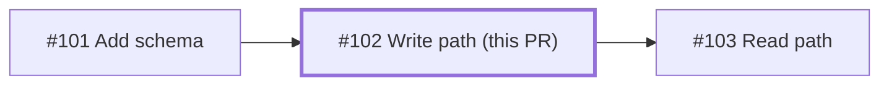
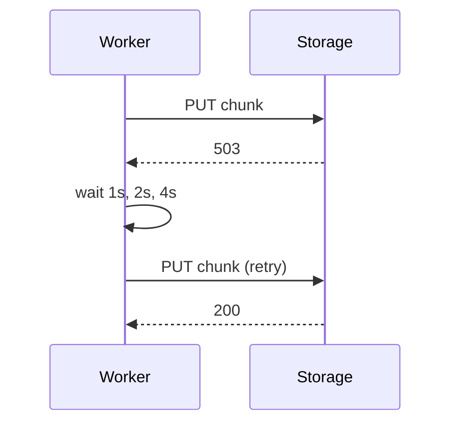

# PR craft

Write the shortest description that lets a reviewer who has never seen your
session understand and assess the pull request. People skim.

## Voice

If `~/.config/pr-craft/voice.md` exists, read it and write in that voice. It
wins over the default voice where they disagree. Otherwise write as a tired,
plain-spoken engineer: short sentences, concrete nouns, no hype.

## Before you write

Read the diff (`git diff <base>...HEAD`) and the issue or design it belongs to.
Answer these for yourself. They are questions, not sections:

- Why does the change exist, and who benefits?
- What behaves differently before and after?
- Which design choice or risk should the reviewer check instead of trust?
- Is this one PR of a stack or a series? What comes before and after?

Write down only the answers a reviewer can't get from the diff. If you don't
know why the change exists, ask.

Open with the problem in the reviewer's terms: what breaks, costs or blocks
today. "Repeated writes count against the write limit, which ran out on
2026-10-15" beats "#43403 will store its cache here".

For a follow-up PR in a stack where an earlier PR or linked thread already
explains why, state what this PR changes and link to that background.

## Size it to the change

- A diff of 200 lines or fewer gets a few paragraphs and no headings. The
  exceptions are `## Manual verification`, `## Before merging` and
  `## Rollout`, because they tell someone to act.
- Add headings, a diagram or a reading order only when the reviewer would get
  lost without them.
- Never narrate the code or inventory the diff. Don't paste code, list test
  classes or methods, write a change list of resources, roles, config fields
  or files, or walk through how a mechanism works step by step. The Files tab
  already shows names, defaults, retention, batch sizes, regexes, log formats
  and metric tags. State the logical effect in one to three plain sentences
  and keep only the design choices, risks or caveats a reviewer must judge or
  act on.
- Don't add `Testing`, `Verification`, `Validation` or `Test plan` sections.
  CI shows builds, tests and linters. When you have evidence beyond CI, such as
  a manual run against a real system, put it under `## Manual verification`.

## Say what someone must act on

Reviewers and deployers act on conditions, so state each one as a plain
instruction, not an implication:

- What must happen before merging, and who checks it: "Merge only after the
  one-hour production run shows no errors on the dashboard."
- What stays unused or inert until which PR: "Nothing reads the table until
  #43403."

A check that still has to happen is an instruction, never a result. Don't
write "ran for an hour with no errors" when the reviewer must still run it.

When the PR is part of a stack, say what each other PR actually does, such as
"#43403 adds the cache in observe mode; #43625 turns skipping on".

Claim no more than the code does, in prose and in diagrams. If some calls skip
a step, don't write "every call". Simplify prose and diagrams unless the
simplification would mislead a reviewer about behavior.

Merge and rollout steps go under `## Before merging` or `## Rollout`. A short
section there doesn't count toward the word budget, so never cut a step to fit.

## Show what is hard to reconstruct

For each part of the change, ask what the reviewer would otherwise rebuild
from the diff in their head. Draw that, using Mermaid. GitHub renders it.

| Reviewer question | Form |
|---|---|
| Who calls whom, in what order | `sequenceDiagram` |
| How data or control moves between parts | `flowchart LR` |
| Which states something passes through | `stateDiagram-v2` |
| Which inputs lead to which outcomes | a small table |
| What a request or record looks like now | a trimmed schema or JSON sketch |
| What changes for the user | before and after, same scenario on both sides |

A diagram or table replaces prose. Never explain the same mapping or flow in
both a paragraph and a table. Add a schema example table only when this PR
creates the table, manifest or wire format itself.

Start with one diagram for the central idea. When the PR adds or changes a
call path, such as a cache, a retry or a new step between services, that path
is the central idea: draw it as a `sequenceDiagram`. Add a second diagram only
when it answers a different question. Keep labels short and only the nodes
that matter.

When this PR sits between other PRs in a stack, show where:



When it only has to land before another PR, a sentence is enough: "The table
must exist before #43403 merges."

## Example

A 640-word draft for a retry change had sections for Summary, Changes (one
bullet per file), Testing and Notes. The rewrite keeps what the reviewer needs:

````markdown
Uploads that fail with a 503 now retry up to three times with backoff instead
of failing the whole batch. Last week one flaky storage node failed 40 batches.



Retries only cover 503 and connection resets. A 4xx still fails at once, so a
bad request never retries. Check `RetryPolicy.should_retry` for that rule.

## Manual verification

Ran a batch of 500 uploads against a staging bucket with fault injection at
10%. All 500 landed; 52 needed one retry and 3 needed two.
````

## Before you submit

- Cut each sentence the reviewer would not miss. Expect the draft to shrink.
- Check each "all", "every", "only" and "never", each diagram arrow and each
  claim about another PR against the code or the context. Cut or narrow what
  you can't point to. Shortening tends to turn "most" into "every".
- Use plain words, straight quotes and no em dashes.
- Write for a reviewer with no access to your conversation. Leave no
  references to a chat, a session or earlier drafts.
- When you edit an existing description, rewrite it as a whole.

A hook checks the body when you run `gh pr create` or `gh pr edit`. If it
denies the command, fix the listed problems and run the command again.
